# NOMAD — Midterm Brief

**Prepared for:** Omer Sajid, CS 521 Fall 2026  
**Purpose:** explain the project, the design choices, the blockers, the current state, and the remaining work for a midterm presentation.  
**Code state:** `e8d9b5c` (`main`), plus the OpenRouter defaults and the GPU runbook.

---

## 0. Premise first

NOMAD asks one question:

> Can one coding agent make the **device-independent** decisions for a fused attention kernel, and
> can a verifier stack **soundly admit** the resulting kernel on more than one device, with only a
> declarative device description changing?

The target is one fused attention block:

```text
RMSNorm → QKV projection → SDPA with softmax → out projection
```

The input and output are `fp16`. The first device is NVIDIA `sm86` (RTX 3070/A40). The second
device is Trainium2 through NKI. The project is not "write one CUDA kernel with an LLM." It is a
compiler pipeline: the agent edits a portable representation, and a sequence of gates checks,
lowers, executes and times the result.

A useful analogy is a recipe and a kitchen. The recipe is the Portable Kernel IR. The kitchen is the
DeviceSpec. The lowering is the chef who turns the recipe into actual cooking. The gates are the
food-safety checks. The recipe should not contain "use the left burner on setting 7" unless the
kitchen description says that burner exists.

The midterm status is short:

> The QKV region is a working vertical slice from PyTorch to CUDA source, PTX, differential test and
> timing. The full attention block is represented and planned, but its RMSNorm, layout, SDPA and
> layout regions cannot lower until the next PKIR constructs land.

---

## 1. Glossary

| Term | Plain meaning |
|---|---|
| **NOMAD** | The project. A device-agnostic, verifier-in-the-loop agentic kernel compiler. |
| **Kernel** | A function compiled for a GPU or accelerator. In this project: a tiled matrix multiply or a fused attention region. |
| **Graph** | A set of tensor operations and the tensors that flow between them. `graph.yaml` is our canonical block graph. |
| **Fusion** | Combining several graph operations into one kernel or one launch region. |
| **Layout** | The order of tensor dimensions in memory. A layout change may be free (a view) or may require a copy. |
| **PKIR** | Portable Kernel IR. A YAML representation of tile-level dataflow: buffers, roles, stages, sync edges and capabilities. |
| **DeviceSpec** | A YAML description of one device: memory tiers, copy engines, tensor-core shapes, synchronization, and cost constants. |
| **Lowering** | Translation from PKIR to a concrete backend, currently CUDA C++ and PTX. |
| **PTX** | NVIDIA's virtual instruction set. `nvcc -ptx` emits it from CUDA device code. It is not the final machine code. |
| **CUDA** | NVIDIA's programming model and C++ dialect for GPU kernels. |
| **NKI** | Neuron Kernel Interface, AWS's kernel language for Trainium. |
| **NEFF** | Neuron Executable File Format, the compiled Trainium artifact. |
| **RMSNorm** | Root-mean-square normalization. It computes a row statistic and scales each row. |
| **QKV** | The fused query, key and value projection. One GEMM produces three output blocks. |
| **SDPA** | Scaled dot-product attention. |
| **Out-proj** | The final linear projection after attention. |
| **Gate** | One ordered admission check. Gates are named G0 through G5. |
| **G0** | Parse gate: YAML syntax and schema. |
| **G1** | Static gate: plan legality, PKIR types, capabilities, capacity, placement. |
| **G2** | Verify gate: slot discipline now; symbolic equivalence is planned. |
| **G3** | Lowering gate: PKIR to CUDA source, optionally PTX; compile on the GPU box. |
| **G4** | Differential-test gate: run the lowered kernel and compare it to PyTorch. |
| **G5** | Timing gate: measure the kernel and compare it to a baseline. |
| **Differential test** | Run two implementations on the same input and compare outputs. |
| **Slot edge** | A declared producer/consumer synchronization edge, such as `A.full` or `A.free`. |
| **Structural vs semantic** | Structural means "the document is well formed." Semantic means "the kernel computes the right answer." |
| **Occupancy** | How many thread blocks can run on one SM at the same time. |
| **Scaffold** | A generated starting PKIR file for a plan group. |
| **Snapshot** | A copy of an admitted plan, kernels and artifacts. |
| **Harness** | The code that owns the workspace, gates, lowering, diagnostics and result. |
| **Agent** | The external model that edits `plan.yaml` and `kernels/*.pkir.yaml`. It never edits CUDA. |
| **OpenRouter** | An API gateway for many models. The default agent model is `deepseek/deepseek-v4-flash`. |
| **Analytic cost model** | A formula-based estimate of bytes, FLOPs and occupancy. It does not time hardware. |

---

## 2. The one-slide thesis

NOMAD separates **what the kernel does** from **how a device realizes it**.

- The agent chooses fusion boundaries, layouts, rewrite order, tile sizes and staging.
- PKIR records those choices in a portable form.
- DeviceSpec records the hardware facts.
- The lowering turns PKIR plus DeviceSpec into CUDA.
- The gates reject bad choices with located diagnostics.
- The same agent and the same diagnostics should work for `sm86` and `trn2`.

The research bet is that these decisions are mostly device-independent. The engineering bet is that
a small, typed IR plus template lowerings is enough to make the separation real for one block.

---

## 3. The problem

### 3.1 Three gaps in the current state of the art

The proposal identifies three gaps.

1. **Single-vendor agents.** The compiler-agent CAKE is NVIDIA-only. TritorX targets one ASIC. AWS's NKI agent needs a
   Trainium device in the loop. None of them retargets from a declarative hardware description.
2. **Kernel-level, not graph-level.** Fusion, data layout and rewrite synthesis are where
   end-to-end performance comes from. These decisions usually sit outside the agent's action space.
3. **Correctness is empirical.** Kernels are admitted by `np.allclose` or OpInfo tests. Audits such
   as KernelBench-Verified and KernelGuard find test-passing kernels that are still broken. Formal
   checkers such as Volta and ProofWright are offline and NVIDIA-specific.

### 3.2 A concrete example

Take the QKV projection used in the worked example.

```text
x: [M, K] = [128, 1024]      fp16
w: [N, K] = [3072, 1024]     fp16
y: [M, N] = [128, 3072]      fp16
```

The math is `y = x · wᵀ`.

The chosen tile is:

```text
tile.m = 64, tile.n = 64, tile.k = 32
warps = 2 × 2 = 4 warps = 128 threads
shared = 37,888 bytes
occupancy hint = 2 blocks per SM
FLOPs = 805,306,368
```

Why these numbers matter:

- `64 × 64` is the output tile.
- `32` is the K-tile. Two K-tiles at a time fit in the shared-memory budget.
- `128` threads is four warps. The warps split the `64 × 64` tile into four `32 × 32` warp tiles.
- Each warp tile is made of `16 × 16 × 16` tensor-core MMA operations.
- The shared-memory footprint fits two blocks per SM on the target device.
- The `A` and `B` operands use `cp.async` 16-byte copies with two pipeline stages.

This one region is enough to test the whole philosophy. It has a graph, a plan, a PKIR document, a
lowering, a PTX artifact, a differential test and a timing result. It also has a clear semantic
failure mode: a missing zero-pad on the last K-tile still looks structurally valid, but reads
out-of-bounds data.

---

## 4. System overview

### 4.1 The pipeline

```mermaid
flowchart LR
    A[PyTorch module or reference block] --> B[torch.export / graph adapter]
    B --> C[graph.yaml]
    C --> D[Agent reads graph, catalog, plan, kernels]
    D --> E[plan.yaml: fusion, layouts, rewrites]
    E --> F[kernels/GROUP.pkir.yaml]
    F --> G[G0 parse]
    G --> H[G1 static]
    H --> I[G2 verify]
    I --> J[G3 lower]
    J --> K[CUDA source]
    K --> L[PTX]
    K --> M[Compiled extension]
    M --> N[G4 differential test]
    N --> O[G5 timing]
    O --> P[Admitted snapshot and result]
```



### 4.2 The four system pieces

| Piece | What it owns | Main files |
|---|---|---|
| **DeviceSpec** | Hardware facts: memory tiers, copy engines, MMA shapes, sync primitives, cost constants | `src/nomad/devicespec/`, `src/nomad/devices/sm86.yaml` |
| **PKIR** | Portable tile-level program: tensors, tile, grid, roles, buffers, placement, body | `src/nomad/pkir/models.py`, `expr.py`, `static.py` |
| **Agent + harness** | Workspace, agent protocol, plan/catalog, gates, diagnostics, snapshots | `src/nomad/graph/`, `src/nomad/harness/`, `src/nomad/agent/` |
| **Verification + measurement** | Slot checks, differential tests, timing, cost model | `src/nomad/verifier/`, `src/nomad/difftest/`, `src/nomad/cost/` |

### 4.3 What the agent can see and edit

The agent sees:

- `task.yaml`: device, shapes, mode, gates, start state, seed, budget.
- `graph.yaml`: the block's operations and tensor declarations.
- `catalog.yaml`: allowed fusion patterns, layout set and rewrite rules.
- `plan.yaml`: the current fusion plan.
- `kernels/*.pkir.yaml`: the current regions.
- `diagnostics/latest.json`: the last gate report.

The agent may edit:

- `plan.yaml`
- `kernels/*.pkir.yaml`

The agent may not edit:

- `task.yaml`
- `graph.yaml`
- `devicespec.yaml`
- `catalog.yaml`

The harness hashes the read-only files and refuses to run if one changed. The agent never writes
CUDA or NKI. Lowering is harness-owned. This is the main security boundary.

### 4.4 Scope

**In scope for v0:**

- One fused attention block, fp16.
- `sm86` CUDA path.
- `trn2` NKI path, simulated.
- Fusion plan, layout set and gated rewrites.
- PKIR regions with explicit sync edges.
- Ordered gates and localized diagnostics.
- Differential tests and timing.
- Bug-injection study.
- Portability and ablation experiments.

**Out of scope or stretch:**

- Arbitrary PyTorch models.
- General-purpose code generation.
- Thread-level scheduling by the agent.
- Volta formal checking. It is a stretch goal.
- On-device Trainium runs. They are a bonus.

---

## 5. The gate stack

The gate order is the core correctness argument. A gate never repairs a submission. It accepts or
rejects it.

| Gate | Question it answers | Current implementation | Failure codes |
|---|---|---|---|
| **G0 parse** | Is the YAML valid and schema-correct? | Implemented. Plan and every PKIR file are parsed. Unknown keys are errors. | `P-*` |
| **G1 static** | Is the plan legal, and is each region structurally legal for this device? | Implemented. Partition, pattern, order, layouts, rewrites, tensor names, slices, placement, capacity. | `S-*` |
| **G2 verify** | Are the declared producer/consumer edges complete? | Implemented for slot discipline. Async copy signals `full`; staged copy waits `free`; matmul waits `full` and releases `free`; epilogue publishes/consumes. | `V-*` |
| **G3 lower** | Can the region be realized? | Implemented for the tiled-GEMM template. Writes `lowered/GROUP.cu`; emits `.ptx` when `nvcc` exists. It does not build the extension; G4 builds it. | `L-*` |
| **G4 difftest** | Does the lowered kernel compute the reference result? | Implemented for single-linear groups. Builds the extension and compares every bound shape against `F.linear` at `atol = rtol = 2e-2`. | `D-*` |
| **G5 time** | How fast is it? | Implemented for single-linear groups. CUDA-event timing, per-shape speedup and geomean. It never rejects. | none |

### What G2 is and is not

G2 is a **slot-discipline verifier**, not the full symbolic-equivalence core from the proposal.

It catches:

- an async copy that never signals `full`;
- a staged copy that never waits for `free`;
- a matmul that consumes without `full`;
- a matmul that never releases `free`;
- an epilogue store that reads without `C.full`;
- malformed slot names or unknown buffers.

It does **not** catch a missing zero-pad, a missing output mask, or a wrong numeric expression.
Those are G4's job. This is a deliberate scope compromise for the first vertical slice. It is the
single largest remaining correctness gap in the system.

### What a good diagnostic looks like

Every diagnostic carries:

- a code, such as `S-SLICE` or `V-RACE`;
- a file and line;
- a JSON Pointer into the YAML;
- an optional group name;
- a short message (300 characters maximum);
- an optional hint.

The report is bounded to five diagnostics. That keeps the agent's feedback cost predictable. Raw
compiler output goes to the log, not to the agent.

---

## 6. What is implemented now

### 6.1 By layer

| Layer | State | Evidence |
|---|---|---|
| DeviceSpec | `sm86` complete; `trn2` not implemented | `src/nomad/devices/sm86.yaml` |
| Canonical graph | QKV and attention-block graphs; torch.export adapter for one linear and the reference block | `src/nomad/reference/block.py`, `src/nomad/graph/ingest.py` |
| Plan/catalog | Four patterns, three rewrites, two layout families; validation; feasible rewrite enumeration | `src/nomad/graph/` |
| PKIR parser/checker | v0.1 models, expression parser, slice parser, static checks | `src/nomad/pkir/` |
| G2 | Slot verifier | `src/nomad/verifier/` |
| G3 | Tiled-GEMM CUDA template; source and PTX artifacts | `src/nomad/lowering/cuda/tiled_gemm.py`, `src/nomad/harness/lower.py` |
| G4 | Build extension and compare per shape | `src/nomad/difftest/groups.py` |
| G5 | CUDA-event timing and speedup | `src/nomad/harness/check.py` |
| Agent | Prompt, complete-file update protocol, OpenAI-compatible client, OpenRouter defaults | `src/nomad/agent/driver.py` |
| Harness | Workspace, hashes, budgets, snapshots, CLI | `src/nomad/harness/` |
| Tests | 73 CPU tests pass; 20 GPU/NKI tests are deselected | `uv run pytest -m "not gpu and not nki"` |
| Lint | Ruff check and format clean | `uv run ruff check`, `uv run ruff format --check` |

### 6.2 Verified artifacts

```text
qkv_proj:
  lowered/qkv_proj.cu     6,893 bytes
  lowered/qkv_proj.ptx   22,933 bytes, .version 8.5, .target sm_86
  shared_bytes           37,888
  threads                128
  tile                   [64, 64, 32]
  warps                  [2, 2]
```

The PTX was generated with `nvcc 12.6.3` in the
`nvidia/cuda:12.6.3-devel-ubuntu22.04` container. No GPU was needed for `nvcc -ptx`. The GPU is
needed for G4 and G5.

### 6.3 What the current end-to-end command does

```sh
uv run nomad init qkv_proj results/runs/gpu-qkv --start unfused
uv run nomad check results/runs/gpu-qkv --upto G3
uv run nomad check results/runs/gpu-qkv --upto G5   # on the GPU box
uv run nomad submit results/runs/gpu-qkv
```

On a CPU-only Mac, G0 through G3 pass. G4 returns `D-UNAVAILABLE` because no CUDA runtime exists.
That is intentional. The harness does not fake a runtime result.

---

## 7. Design decisions

The following list uses the format from the answer profile: problem, naive approach, chosen
approach, cost, and the condition that would make us reverse the choice.

### Decision 1 — Start with one fused attention block

**Tag:** load-bearing.

**Problem:** a general graph compiler is unbounded. We need a concrete target that exercises fusion,
layout, synchronization, reductions and attention.

**Naive approach:** take arbitrary PyTorch models and let the agent optimize everything. This makes
the reference, verification and evaluation impossible to finish in one semester.

**Chosen approach:** one fixed block: RMSNorm → QKV → SDPA → out-proj, with a fixed shape table and
one fp16 contract.

**Cost:** the result is not a general compiler. A new block needs a new graph and, often, a new
lowering.

**Reverse if:** the block becomes too small to demonstrate graph-level gains, or the evaluation
needs a second block to prove generality. The current evidence already shows the QKV region alone is
not enough for the full performance story.

### Decision 2 — Put portability in DeviceSpec, not in the agent

**Tag:** load-bearing.

**Problem:** CUDA and NKI differ in memory tiers, sync primitives, copy engines and MMA shapes. If
the agent sees those details, the same agent cannot serve both devices.

**Naive approach:** let the agent emit CUDA or NKI directly. This is what many single-vendor agents
do. It couples every decision to one vendor.

**Chosen approach:** DeviceSpec is a YAML capability description. PKIR reads only the keys in
`docs/pkir-spec.md §10`. The lowering owns the device realization.

**Cost:** the abstraction can leak. A construct that one device handles easily may not be expressible
on the other. The current `trn2` file does not exist yet, so the portability claim is only proven on
paper plus `sm86`.

**Reverse if:** the two devices need fundamentally different IRs. The fallback in the proposal is to
restrict Trainium to softmax, not to weaken the CUDA path.

### Decision 3 — PKIR is tile-level, not thread-level

**Tag:** load-bearing.

**Problem:** the agent must choose staging, buffers, roles and sync edges. It should not choose
individual thread indices.

**Naive approach:** expose thread-level CUDA in the IR. The search space explodes, and verification
becomes a CUDA verifier.

**Chosen approach:** PKIR describes tiles, staged buffers, roles (`move` or `matrix`), explicit
`wait`/`signal` edges, affine slices and a fixed set of capability ops. The lowering maps warps and
threads.

**Cost:** the IR cannot express every optimization. The current v0.1 is intentionally narrow: fill,
copy, for, matmul. It has no reduction, no transcendental op, no running softmax state and no
layout step.

**Reverse if:** a target optimization cannot be expressed without thread-level control. The planned
escape hatch is a new capability with a semantic contract, not raw CUDA in the IR.

### Decision 4 — Template lowering first, general codegen later

**Tag:** load-bearing for v0; tunable later.

**Problem:** writing a general CUDA code generator is a compiler project by itself.

**Naive approach:** generate arbitrary CUDA from first principles. This would be hard to verify and
hard to debug.

**Chosen approach:** match a canonical tiled-GEMM document, check every field, and emit a known-good
CUDA template. The template realizes the declared edges, pads, masks, strides and assumptions. The
emitted source is deterministic for a given document.

**Cost:** only the GEMM template exists. The agent cannot invent a new schedule shape; it can only
change the parameters the template accepts. The full block needs more templates or a general
lowering.

**Reverse if:** the template set grows large enough that matching becomes a second compiler. Then a
real code generator becomes cheaper.

### Decision 5 — The agent edits plans and PKIR, never CUDA

**Tag:** load-bearing.

**Problem:** if the agent writes CUDA, the device-independent claim disappears. It can also bypass
the verifier.

**Naive approach:** let the agent write source and run `nvcc` directly. This is fast to prototype and
unsafe.

**Chosen approach:** the agent's shell is restricted to the harness commands. It edits only
`plan.yaml` and `kernels/*.pkir.yaml`. The harness owns lowering and compilation. Read-only files are
hashed.

**Cost:** the agent cannot express a new operation that the IR lacks. That is exactly the current
full-block blocker.

**Reverse if:** the IR becomes expressive enough that the restriction blocks legitimate schedules.
The answer would be an explicit, reviewed extension, not a raw-source escape hatch.

### Decision 6 — Ordered gates with localized diagnostics

**Tag:** load-bearing.

**Problem:** an LLM can produce plausible YAML that is structurally valid and numerically wrong.

**Naive approach:** one `allclose` check at the end. This gives a single pass/fail and no guidance.

**Chosen approach:** G0 parse → G1 static → G2 verify → G3 lower → G4 difftest → G5 timing. Each
failure stops the stack and returns a located diagnostic. G5 never rejects.

**Cost:** the gate stack adds latency and implementation work. The original G1-only study showed
22/22 structural mutants caught and 0/6 semantic mutants caught. The new gates target the semantic
cases, but the full mutation study has not been rerun with the new stack.

**Reverse if:** the diagnostics are too noisy to help the agent. The current design keeps the report
bounded to five items for that reason.

### Decision 7 — G2 starts with slot discipline, not symbolic equivalence

**Tag:** load-bearing; incomplete.

**Problem:** the proposal promises memory safety, race/deadlock freedom and symbolic equivalence.
Implementing all three at once would delay the vertical slice.

**Naive approach:** claim G2 is complete because the example passes. That would be false.

**Chosen approach:** implement the synchronization half first. Check every declared slot edge and
every operand publication. Leave numeric equivalence to G4. Mark the symbolic core as reserved.

**Cost:** a missing pad or mask passes G2. G4 catches it only if the shape triggers the difference.
The project cannot yet claim "sound for all static shapes."

**Reverse if:** the G4 shape table becomes the only correctness evidence. At that point the
equivalence core moves onto the critical path.

### Decision 8 — Canonical graph plus a structural PyTorch adapter

**Tag:** load-bearing; partial.

**Problem:** the agent should not depend on Torch export internals. The graph must be stable and
readable.

**Naive approach:** let the agent read the exported FX graph directly. The agent then sees Torch
implementation details and loses portability.

**Chosen approach:** `graph.yaml` is the canonical form. The adapter recognizes one bias-free linear
and the reference attention block. Other graphs must be supplied as `graph.yaml`.

**Cost:** arbitrary PyTorch models do not work yet. The block recognition is structural, not a
general exporter. It can misclassify a structurally similar graph.

**Reverse if:** a second real model enters scope. Then the adapter needs shape and semantic
validation, not just an op-count match.

### Decision 9 — Catalog-limited action space

**Tag:** convention for v0; tunable.

**Problem:** the agent needs a finite, reviewable set of graph actions.

**Naive approach:** allow any rewrite or fusion the model invents. This is hard to validate and
reproduce.

**Chosen approach:** four patterns (`single`, `norm_gemm`, `attention`, `attn_out`), three rewrites
(`fold_norm_gain`, `norm_as_row_scale`, `fold_attn_scale`) and two layout families for `qkv` and
`o`. Catalog entries are added by PR, never by the agent.

**Cost:** the search space is small. `nomad explore` enumerates 8 feasible rewrite sequences. It
does not enumerate match bindings, grouping partitions beyond the catalog, or arbitrary layouts.

**Reverse if:** the agent consistently finds no improvement because the catalog is too small. The
planned expansion is more patterns and layouts, not arbitrary code.

### Decision 10 — Two start states: scratch and unfused

**Tag:** tunable; currently drifting from the contract.

**Problem:** the agent needs a baseline and a blank canvas.

**Naive approach:** always start from an empty kernel. The agent then spends its budget on syntax.

**Chosen approach:** `unfused` writes one `single` group per op and a scaffolded template.
`scratch` writes the same plan but leaves the agent to author the PKIR. The contract says the default
is `unfused`; the CLI currently defaults to `scratch`.

**Cost:** the default drift is a real contract mismatch. It changes what "the agent did" means in an
experiment. The scaffold also leaks a hand-written schedule into the baseline.

**Reverse if:** the agent cannot produce a valid file from scratch. The scaffold is the fallback.

### Decision 11 — Analytic cost model, not a hardware counter

**Tag:** tunable.

**Problem:** the agent needs feedback before a GPU is available.

**Naive approach:** run the kernel for every candidate. This is slow and unavailable on the laptop.

**Chosen approach:** compute FLOPs, bytes per block, shared/register footprint and an occupancy hint
from PKIR plus DeviceSpec.

**Cost:** the numbers are estimates. The occupancy value was initially wrong because the DeviceSpec
claimed 128 KB of usable shared memory per SM instead of 100 KB. After the fix, the QKV example
reports two blocks per SM, matching the spec. The model is still not calibrated against measured
throughput.

**Reverse if:** measured timing and the model disagree by more than a useful margin. Then the model
needs calibration constants or should be demoted to a filter.

### Decision 12 — Complete-file updates for the agent

**Tag:** convention.

**Problem:** the agent must communicate changes without a complex patch protocol.

**Naive approach:** ask for a structured diff. Small models often fail at diff syntax.

**Chosen approach:** the model returns complete YAML files, each introduced by
`### FILE: <path>` and a fenced YAML block. The driver validates the path, parses the YAML and
writes the file.

**Cost:** the response is token-heavy. A model can corrupt a large file while fixing one field. The
local 2.9B reasoning model did exactly that in a manual trial: it produced an invalid slice, and G1
rejected it with `S-SLICE`.

**Reverse if:** the model reliably produces smaller patches. A patch protocol would reduce tokens
and corruption risk.

### Decision 13 — CPU can stop at G3; G4/G5 need the GPU

**Tag:** convention for the current lab setup.

**Problem:** the development laptop has no NVIDIA GPU.

**Naive approach:** skip lowering tests on the laptop, or fake success.

**Chosen approach:** G3 writes source on any machine. G4 returns `D-UNAVAILABLE` when
`torch.cuda.is_available()` is false. G5 runs only after G4. A GPU test
(`tests/gpu/test_pipeline_gpu.py`) is ready for the GPU box.

**Cost:** a CPU-only checkout can admit a source artifact without executing it. That is weaker than
the contract's "lower then compile." The code labels this state clearly and does not claim a runtime
pass.

**Reverse if:** CI gains a GPU runner. Then G4/G5 become mandatory in CI.

### Decision 14 — OpenRouter as the default agent provider

**Tag:** tunable.

**Problem:** the local 2.9B reasoning model often spends its entire token budget on reasoning and
returns no content.

**Naive approach:** hard-code a local endpoint. This makes the agent unusable off the laptop.

**Chosen approach:** default to OpenRouter and `deepseek/deepseek-v4-flash`, with
`OPENROUTER_API_KEY` in the environment. A local endpoint can still be selected explicitly.

**Cost:** the provider is an external dependency. The supplied provisioning key cannot call
`/chat/completions`; it returns 401 `User not found`. An inference key is required. The key must
never be committed.

**Reverse if:** the API cost or rate limit makes the pilot runs impractical, or a local model becomes
reliable enough.

### Decision 15 — Snapshots and a closed result

**Tag:** convention.

**Problem:** an admitted run must be reproducible after the workspace changes.

**Naive approach:** keep only the final plan. The exact kernel that passed is lost.

**Chosen approach:** every admission copies the plan, task, graph, DeviceSpec, catalog, kernels,
diagnostics and `lowered/` artifacts into `snapshots/NNN/`. `nomad submit` closes the run and picks
the admitted snapshot with the best recorded metrics.

**Cost:** storage and a little complexity. The benefit is a defensible evaluation artifact.

**Reverse if:** snapshot size becomes a problem. Then store hashes and rebuild artifacts
deterministically.

---

## 8. Blockers and failures

### 8.1 The lowering was not on `main`

The first audit found only one-line docstrings under `src/nomad/lowering/`. The CUDA path did not
exist on `origin/main`. A teammate had a branch (`hkohli/lower-cuda`) with a GEMM template and tests.
We merged that branch. This was a coordination blocker, not a design failure.

### 8.2 No CUDA GPU on the development machine

The Mac has no `nvcc` and no CUDA runtime. This blocks:

- loading the generated extension;
- running G4 and G5;
- measuring the kernel;
- running the oracle comparison.

What we did instead:

- generated the CUDA source on CPU;
- compiled the device-only source to PTX with `nvcc` in a CUDA 12.6.3 container;
- wrote `tests/gpu/test_pipeline_gpu.py` for the GPU box;
- made `D-UNAVAILABLE` an explicit rejection, not a pass.

What remains unproven: the generated kernel actually produces the reference output on hardware.

### 8.3 The full block does not fit PKIR v0.1

The block graph is:

```text
norm:  rmsnorm(x, g) -> h
qkv:   linear(h, w_qkv) -> qkv
split: layout(qkv) -> q, k, v
attn:  sdpa(q, k, v) -> o
merge: layout(o) -> o2
out:   linear(o2, w_o) -> y
```

Only the linear groups are supported. G1 rejects `norm`, `split`, `attn` and `merge` with
`S-UNSUPPORTED`.

The missing PKIR constructs are listed in `docs/pkir-spec.md §9`:

- intra-tile reductions and broadcasts;
- elementwise `exp` and `rsqrt` with accuracy contracts;
- register-resident running softmax state;
- multi-region programs that share buffers;
- causal masks and predicates beyond rectangular tiles;
- layout transforms as first-class steps;
- alignment padding for ragged rows;
- a thread-map construct for placement proofs;
- atomics and split-K;
- `trn2` capability queries.

This is the main scope blocker. It is not a bug in the gate wiring. It is the next IR version.

### 8.4 G2 is not yet the proposed verifier

The proposal promises soundness for static shapes, affine indexing, structured sync and region
equivalence. The current G2 checks only slot discipline. We can honestly say:

- race/deadlock-style slot omissions are checked;
- numeric equivalence is checked by G4 on the sampled shapes;
- symbolic equivalence is not implemented.

This is the largest correctness gap relative to the proposal.

### 8.5 NKI and Trainium are not implemented

`src/nomad/lowering/nki/` is a docstring. `src/nomad/devices/trn2.yaml` does not exist. The
portability claim is an interface claim, not a measured result. The proposal's fallback is to
restrict Trainium to softmax if NKI lowering slips.

### 8.6 The agent model is unreliable at large rewrites

The local 2.9B reasoning model succeeded on a scaffolded tile edit and a diagnostic repair. It failed
on from-scratch generation and rewrite selection because it spent all tokens on reasoning and
returned no content. In a later full-file repair, it produced an invalid slice. The driver rejected
it and returned `S-SLICE`.

OpenRouter is now the default. The supplied key was a provisioning key, not an inference key. The
provider returns 401 `User not found` on `/chat/completions`. An inference key works; the code reads
it from `OPENROUTER_API_KEY` and never commits it.

### 8.7 The graph adapter is not general

`torch.export` support exists for one bias-free linear and the reference attention block. The block
match is structural. Arbitrary models must supply `graph.yaml`. This is acceptable for v0 but not
the general claim.

### 8.8 Evaluation is incomplete

Not yet measured or completed:

- GPU G4/G5 for the QKV kernel;
- block-level latency against eager, SDPA and `torch.compile`;
- the full bug-injection study under G2-G5;
- portability by swapping `devicespec.yaml`;
- kernel-only vs graph-level agent ablation;
- the final report.

### 8.9 Contract drift

`nomad init` defaults to `scratch`, while the agent contract says the default start state is
`unfused`. This is a real mismatch. It should be fixed before the pilot runs, because it changes the
baseline and the interpretation of agent improvement.

---


## 9. Evaluation status

### 9.1 Tests

```text
CPU subset:   73 passed, 20 deselected
Ruff:         check and format clean
```

The GPU/NKI tests are skipped by design. The GPU test file is ready but has not run on the RTX 3070
or A40.

### 9.2 Gate quality from the earlier mutation study

The study injected 28 directed mutants and checked the first diagnostic.

| Class | Caught by G1 only | Note |
|---|---:|---|
| Structural | 22 / 22 | Unknown keys, schema, partition, pattern, layout, rewrite order, placement, capacity, slices, casts, missing files |
| Semantic | 0 / 6 | Dropped pad, missing mask, missing slots, non-transposed weight, wrong stride, missing store wait |

The semantic result was expected because G1 is structural. The new gates target those cases:

- missing slots → G2 `V-RACE`;
- non-transposed weight → G3 `L-TEMPLATE`;
- wrong stride → G1/G3;
- missing pad or mask → G4 `D-MISMATCH`.

The study has not been rerun end to end with G2-G5. That is a remaining evaluation task. Do not
present the old 0/6 number as the final gate quality.

### 9.3 Cost model

For the QKV shape:

```text
M=128, N=3072, K=1024
FLOPs:          805,306,368
shared:         37,888 B
register:       16,384 B
occupancy hint: 2 blocks/SM
bytes/block:    270,336
```

The A40 shared-memory capacity in the DeviceSpec is 102,400 B. The earlier spec said 128 KB and
predicted three blocks per SM. The corrected value predicts two, matching the PKIR worked example.

The model is analytic. It is useful for filtering, not for claiming speed.

### 9.4 What the midterm can claim

Supported claims:

- The QKV vertical slice runs from PyTorch to CUDA source and PTX.
- G0-G3 pass on CPU; the artifacts are deterministic.
- The generated device source compiles to PTX for `sm_86`.
- G4/G5 are implemented and have a GPU test.
- The full attention block imports and plans; it is rejected by static checks for four known
  unsupported regions.

Claims that are not yet supported:

- "The full block runs on the GPU."
- "NOMAD is portable to Trainium."
- "The verifier is sound for all shapes."
- "The agent beats `torch.compile`."
- "The full bug-injection study passes."

---

## 10. What remains

### Critical path

1. **Run G4/G5 on the GPU box.** Use `tests/gpu/test_pipeline_gpu.py` and the runbook. This turns the
   vertical slice from "source generated" into "kernel runs and is measured."
2. **Implement PKIR v0.2 constructs for the full block.** Start with RMSNorm reductions and layout
   steps, then online softmax state, then the attention region. This is the largest engineering item.
3. **Rerun the mutation study under G2-G5.** Report which gate catches each mutant.
4. **Measure block latency** against eager, SDPA and `torch.compile`.
5. **Portability experiment.** Implement enough NKI to lower at least softmax or RMSNorm, then swap
   only `devicespec.yaml`.
6. **Ablations.** Kernel-only vs graph-level agent; with and without gates.
7. **Final report and artifact README.**

### What can be cut

The proposal already defines fallbacks:

- If NKI slips, restrict Trainium to softmax.
- If equivalence slips, fall back to static + differential checks + Volta on CUDA.
- Never cut GPU end-to-end results and the bug-injection study.

### Recommended sequencing

**Next 48 hours:** GPU G4/G5 and the mutation rerun. Without those numbers, the midterm is a
compiler demo without a hardware result.

**Next week:** PKIR v0.2 reductions, `exp`/`rsqrt`, and layout steps. That unlocks the RMSNorm and
layout groups.

**After that:** attention state and SDPA. This is the hardest region. It needs register-resident
running state and a mask construct.

**Last:** NKI and ablations. They are important for the final claim but not for the QKV demo.

---

## 11. Midterm presentation plan

### 11.1 A 12-minute slide sequence

| Slide | Content | Time |
|---|---|---:|
| 1 | Title and one-sentence thesis | 0:30 |
| 2 | Problem: single-vendor, kernel-level, empirical correctness | 1:15 |
| 3 | Insight: decisions are device-independent; realization is not | 1:00 |
| 4 | Target block and concrete QKV numbers | 1:15 |
| 5 | Architecture diagram: graph → agent → PKIR → lowering → gates | 1:30 |
| 6 | PKIR and DeviceSpec: what the agent sees and what it never sees | 1:15 |
| 7 | Gate stack: G0-G5 and a located diagnostic example | 1:30 |
| 8 | Current vertical slice: QKV artifact numbers | 1:15 |
| 9 | Demo or screenshots: `.cu`, `.ptx`, diagnostics, snapshot | 1:00 |
| 10 | Design decisions and tradeoffs | 1:00 |
| 11 | Blockers: full block, GPU validation, G2 equivalence, NKI | 1:15 |
| 12 | Remaining work and timeline | 1:00 |
| 13 | What we need from the audience or advisor | 0:30 |

### 11.2 The five-sentence version

If you have one minute:

1. NOMAD is a compiler pipeline for GPU kernels, not a chat interface for CUDA.
2. An agent edits a portable IR and a fusion plan; it never writes device code.
3. Ordered gates reject bad plans with file, line and JSON Pointer diagnostics.
4. The QKV region is end to end: PyTorch → graph → PKIR → CUDA → PTX, with difftest and timing
   wired for the GPU box.
5. The full attention block is blocked by four missing PKIR constructs, not by the agent or the gate
   wiring.

### 11.3 What to demo

Safe laptop demo:

```sh
uv run nomad init qkv_proj results/runs/demo --start unfused
uv run nomad check results/runs/demo --upto G3
uv run nomad lower results/runs/demo
sed -n '1,40p' results/runs/demo/lowered/qkv_proj.cu
cat results/runs/demo/diagnostics/latest.json
```

If `nvcc` is available:

```sh
uv run nomad lower results/runs/demo --ptx
sed -n '1,20p' results/runs/demo/lowered/qkv_proj.ptx
```

GPU demo:

```sh
uv run nomad check results/runs/demo --upto G5
uv run nomad submit results/runs/demo
```

If the GPU is not available at presentation time, show the pre-generated PTX and the passing CPU
tests. State clearly that G4/G5 are pending hardware, not faked.

### 11.4 What not to claim

Do not say:

- "The full attention block works." It does not lower.
- "The verifier is sound." It is a slot verifier plus differential tests.
- "It is portable to Trainium." The interface exists; the backend does not.
- "It is faster than PyTorch." No GPU timing has been recorded.

---

## 12. Likely questions and short answers

**Why not just ask the model to write CUDA?**

Because the project is about device-independent decisions and sound admission. If the model writes
CUDA, the same agent cannot retarget, and the verifier has no portable object to check.

**How is this different from CAKE?**

There are two CAKE references in the workspace. The `cake/` directory is the Gaussian-process
kernel work for Bayesian optimization. The proposal's reference is the compiler-agent co-design
paper. Either way, NOMAD is not the same system: the `cake/` implementation evolves GP kernels, and
the compiler-agent CAKE co-designs a schedule IR with an agent loop. NOMAD adds a device-agnostic
DeviceSpec boundary, PKIR regions and the ordered verifier gates G0-G5. The shared idea is an LLM in
the loop; the object being evolved and the correctness story differ.

**Why PKIR instead of Triton?**

Triton is a vendor-specific language and compiler. PKIR is a device-agnostic dataflow description
with explicit sync edges and a DeviceSpec boundary. The lowering can target CUDA or NKI.

**How do you know the kernel is correct?**

G0 and G1 check structure. G2 checks declared synchronization. G3 checks that the region matches the
lowering template. G4 compares the running kernel to the PyTorch reference over the shape table.
The symbolic-equivalence half of G2 is still future work.

**Can the agent cheat?**

The agent cannot edit read-only files. The harness hashes them. The agent cannot write CUDA or run a
compiler. It can only edit plan and PKIR files. The harness owns lowering and execution.

**Why is G3 allowed to pass on a CPU?**

It is not a compile pass. It is a source-generation pass. The current machine has no CUDA runtime.
G4 rejects with `D-UNAVAILABLE`. On the GPU box, G3 compiles the extension and G4 runs it.

**What is the biggest risk?**

The full attention block is not expressible in PKIR v0.1. If the v0.2 constructs take too long, the
final result is a QKV vertical slice, not a fused attention block.

**What will you cut if time runs out?**

NKI/portability and the symbolic-equivalence core. The proposal's fallback permits both. Do not cut
GPU end-to-end results or the mutation study.

**What is the novel contribution?**

A portable IR plus ordered verifier gates for agentic kernel decisions, with a concrete QKV
vertical slice. The novelty is the separation of agent decisions from device realization and the
localized feedback loop, not the raw CUDA template.

**What did each person do?**

The proposal assigns HK the CUDA path, agent and GPU experiments; OS the DeviceSpec/PKIR, verifier
and NKI path. The integration points I1-I4 are pair-programmed. In the current tree, the teammate's
GEMM lowering and tests were merged; the harness, gates, graph layer, agent driver and runbook were
completed locally.

---

## 13. Concrete next actions

1. Copy the repo to the GPU box and follow `docs/gpu-runbook.md`.
2. Run:

```sh
uv run pytest -m gpu tests/gpu/test_qkv_tile.py tests/gpu/test_lowered_qkv.py -q
uv run pytest -m gpu tests/gpu/test_pipeline_gpu.py -q
```

3. Record the G4 `max_abs_err` and G5 `geomean_speedup`.
4. Rerun the 28-mutant table and record the first gate for each mutant.
5. Fix the `nomad init` default to `unfused` to match the contract.
6. Start PKIR v0.2 with the RMSNorm reduction and the layout step.
7. Defer NKI until the QKV GPU numbers and the full-block lowerings are stable.

The single next action is step 2. A source artifact and a PTX file are evidence of lowering. They
are not evidence of a working kernel. The GPU run is what turns the vertical slice into a result.

---

## Appendix A — File map for the talk

| Path | Why it matters |
|---|---|
| `docs/proposal.pdf` | The original problem, scope, evaluation and risks |
| `docs/pkir-spec.md` | The IR contract, capability table, worked example and expansion points |
| `docs/agent-contract.md` | Files, commands, gates, diagnostics, start states, budgets |
| `docs/lowering-status.md` | Current pipeline status and missing scope |
| `docs/gpu-runbook.md` | Step-by-step GPU procedure |
| `examples/qkv_proj.pkir.yaml` | The worked QKV PKIR document |
| `src/nomad/lowering/cuda/tiled_gemm.py` | The CUDA template |
| `src/nomad/graph/ingest.py` | Torch export to canonical graph |
| `src/nomad/harness/check.py` | The ordered gate stack |
| `src/nomad/agent/driver.py` | Agent protocol and OpenRouter client |
| `tests/gpu/test_pipeline_gpu.py` | The end-to-end GPU test |

## Appendix B — Current commit and state

```text
main = e8d9b5c
OpenRouter defaults committed
GPU runbook in docs/gpu-runbook.md
CPU tests: 73 passed, 20 deselected
```

This brief and the OpenRouter key note are a documentation follow-up. Commit them before the
presentation if the slide deck links to the exact file.